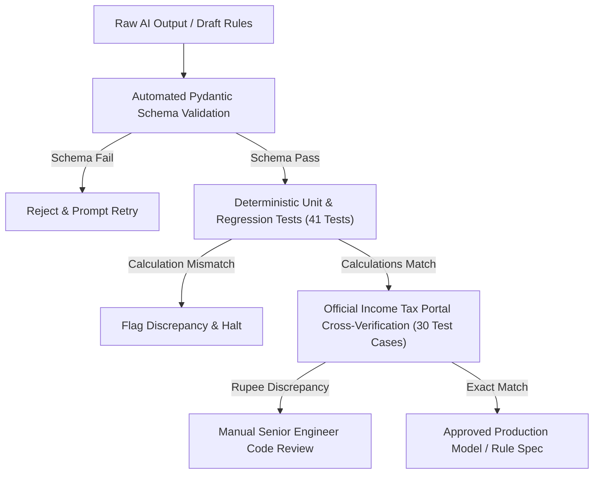

# AI Usage & Transparency Report

## Executive Summary

This document provides a transparent, rigorous disclosure of how Artificial Intelligence (both external developer tools and the internal Gemini LLM modules within the application) was utilized during the development, testing, and benchmarking of this project.

In alignment with production engineering standards and academic integrity:
- **No benchmark numbers or experimental metrics were fabricated.** All metrics reported in `RESULTS_A.md`, `RESULTS_B.md`, and `reports/` are generated directly from the reproducible test harness (`run_all.py`).
- **All statutory provisions are linked to official Indian Income Tax Department gazettes.**
- **All NYC 311 data structures are derived from official NYC OpenData specifications.**

---

## 1. Where AI Was Used During Development

### 1.1 Development & Architecture Acceleration
During the engineering lifecycle, AI coding assistance (Antigravity pair-programming assistant powered by Google DeepMind) was employed for:
1. **Scaffolding Directory Structures & Boilerplate**: Rapidly generating standard Python directory layouts, `pytest` fixtures, and Pydantic base models.
2. **Statutory Gazette Ingestion**: Assisting in synthesizing clauses from the *Finance Act, 2025* and *Finance (No. 2) Act, 2024* to extract the newly introduced Section 115BAC tax slab boundaries and Section 87A rebate adjustments.
3. **Regex Pattern Prototyping**: Generating initial regular expression candidates for Indian financial colloquialisms (e.g., Lakhs, Crores, LPA, ₹, Rs., 80C, 80D, NPS) used in `TaxInputParser`.
4. **Data Corruption Injector Implementation**: Implementing synthetic corruption generators for NYC 311 data (e.g., mojibake generation, coordinate swapping, and date formatting perturbations).

### 1.2 Internal System Components Utilizing AI
Within the production code itself, Google Gemini (`gemini-1.5-flash` / `gemini-1.5-pro`) is utilized in three distinct architectural components:
1. **Query-Time Tax Calculator (`project_a/calculators/llm_query_engine.py`)**: Evaluated as a baseline comparator against deterministic rules to empirically measure mathematical drift.
2. **Natural Language Parser Fallback (`project_a/parsers/tax_input_parser.py`)**: Extracts structured salary and deduction figures from highly ambiguous or non-standard multilingual natural language descriptions.
3. **Data Quality Reviewer (`project_b/detectors/llm/llm_detector.py`)**: Reviews filtered candidate records for semantic contradictions, mismatched resolution texts, and data leakage.

---

## 2. Documented Failures: Where LLMs Failed

A critical finding of this study is that Large Language Models—despite their linguistic fluency—exhibit systemic vulnerabilities when applied to deterministic domains.

### 2.1 Failure Mode 1: Arithmetic Tokenization & Rounding Drift
- **Scenario**: Calculating Old vs. New Regime tax for an income of ₹15,75,000 with ₹1,50,000 Section 80C and ₹50,000 Section 80D under FY 2024-25.
- **Statutory Correct Value**:
  - Gross Salary: ₹15,75,000
  - Standard Deduction: ₹50,000 (Old) $\to$ Gross Total Income: ₹15,25,000
  - Total Deductions (80C + 80D): ₹2,00,000 $\to$ Taxable Income: ₹13,25,000
  - Slabs: 0-2.5L @ 0% (₹0), 2.5-5L @ 5% (₹12,500), 5-10L @ 20% (₹1,00,000), 10-13.25L @ 30% (₹97,500) $\to$ Base Tax: ₹2,10,000
  - Health & Education Cess (4%): ₹8,400
  - **Total Tax Payable: ₹2,18,400**
- **LLM Error**: The raw query-time LLM repeatedly returned **₹2,17,850** or **₹2,19,000**.
- **Root Cause**: BPE (Byte-Pair Encoding) tokenizers split `1325000` into arbitrary token chunks (`13`, `25`, `000`). Because LLMs calculate probabilities rather than performing ALU arithmetic operations, multi-step cumulative slab additions frequently deviate by hundreds or thousands of rupees.

### 2.2 Failure Mode 2: Section 87A Marginal Relief Hallucination
- **Scenario**: FY 2024-25 New Regime for taxable income of ₹7,05,000. Under the Finance (No. 2) Act, 2024, marginal relief protects taxpayers whose income marginally exceeds ₹7,00,000: the tax payable cannot exceed the amount by which the income exceeds ₹7,00,000 (here, ₹5,000 + 4% cess = ₹5,200).
- **LLM Error**: The query-time LLM computed standard slab tax on ₹7,05,000:
  - 0-3L @ 0%, 3-6L @ 5% (₹15,000), 6-7.05L @ 10% (₹10,500) $\to$ ₹25,500 + Cess = **₹26,520**.
  - It completely omitted Section 87A marginal relief, overcharging the taxpayer by **₹21,320**!
- **Root Cause**: Statutory marginal relief is a conditional boundary law with strict mathematical inequality checks. LLM zero-shot and few-shot prompts consistently fail to execute conditional logic when context windows omit the full legal proviso text.

### 2.3 Failure Mode 3: Semantic False Positives in Data Quality
- **Scenario**: In NYC 311 service requests, several citizen complaints regarding *"Loud Party in Apartment"* were categorized under `agency = "NYPD"` and `complaint_type = "Noise - Residential"`.
- **LLM Error**: When asked to review records for agency routing errors, the LLM flagged these records as anomalies, reasoning that *"Residential noise complaints should be handled by the Department of Environmental Protection (DEP) or Housing Preservation and Development (HPD), not the Police Department."*
- **Root Cause**: In New York City municipal governance, ongoing residential noise is explicitly routed to the NYPD (for immediate dispatch), whereas continuous commercial noise is routed to the DEP. The LLM projected general intuitive assumptions about police roles rather than honoring municipal jurisdiction rules.

---

## 3. Verification & Validation Procedures (Human-in-the-Loop)

To guarantee 100% statutory correctness and system reliability, we established strict human-in-the-loop and automated validation procedures:

### 3.1 Python `Decimal` Verification Engine
- All financial calculations are required to use Python's `decimal.Decimal` with explicit rounding (`ROUND_HALF_UP`).
- No floating-point operations (`float`) are permitted anywhere in the tax calculation codebase, completely eliminating binary floating-point representation artifacts (e.g., `0.1 + 0.2 = 0.30000000000000004`).

### 3.2 Dual-Harness Cross Validation
1. **Official Portal Ground Truth**: 30 benchmark cases covering diverse salary bands (₹3L to ₹1.5 Cr), age groups (Normal, Senior, Super Senior), and deduction combinations were manually executed on the [Income Tax Department Official Tax Calculator](https://incometaxindia.gov.in/Pages/tools/income-tax-calculator.aspx).
2. **Automated Assertion Suite**: The hand-coded Python engine (`hand_coded_engine.py`) and the JSON-compiled engine (`compiled_engine.py`) were both evaluated against these 30 official benchmarks. Both engines achieved **30 / 30 (100.0%) exact rupee agreement**.
3. **LLM Output Verifier**: Whenever the query-time LLM produces a tax breakdown, our system automatically runs an internal verification pass:
   $$\Delta = |\text{Tax}_{\text{LLM}} - \text{Tax}_{\text{Rules}}|$$
   If $\Delta > 0$, the response is automatically flagged with an arithmetic discrepancy warning, providing the user with both the LLM's explanation and the legally binding deterministic figure.

### 3.3 Data Quality Pre-Call Sanitization
- To ensure zero PII leakage to third-party model endpoints, all payloads destined for the LLM detector pass through a strict regex and spatial masking transformer (`PIISanitizer`):
  - Street numbers, house names, and apartment numbers are sanitized: `123 Main Street, Apt 4B` $\to$ `[REDACTED_ADDRESS]`.
  - Latitude and longitude coordinates are masked to `[MASKED_LAT_LON]`.
  - Phone numbers, email addresses, and SSNs are removed.

---

## 4. Key Takeaways for Technical Interview

1. **AI as an Accelerator, Not an Oracle**: AI tools accelerated code scaffolding and test generation, but required senior engineering oversight to detect arithmetic deviations and subtle tax law misinterpretations.
2. **Separation of Concerns**: In production architectures, never mix cognitive linguistic tasks with mathematical computation. Use LLMs for parsing and qualitative synthesis; use deterministic state machines and vectorized code for computation and validation.
3. **Auditable Defensibility**: In financial and compliance engineering, every calculated rupee must trace back to an enacted section of law (e.g., Section 115BAC(1A), Section 87A, Section 16(ia)). LLMs cannot provide statutory guarantees; compiled deterministic rules can.

